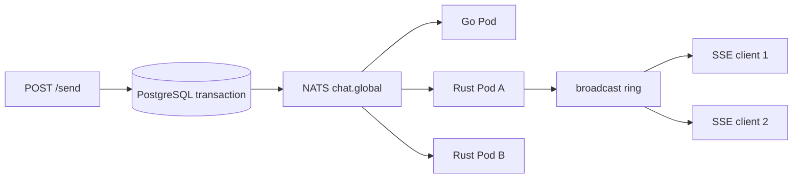

# GoTalk을 읽으며 Rustalk 공부하기

참조 Go 버전은 `1f1bc5a86f3c99c169010dfc496628da6f16c478`입니다. 비교 대상이 움직이지 않도록 CI에서도 이 커밋을 고정합니다. 새 이름과 저장소를 사용하지만 HTTP/DB/NATS 계약은 같은 상태에서 언어와 런타임을 교체합니다.

## 먼저 읽을 순서

1. Go `backend/main.go`의 `main`과 Rust `src/main.rs::run`: 자원 초기화 → 구독 → listen → 종료.
2. Go `initDB`와 Rust `src/db.rs::connect`: 연결 풀, SQL parameter binding, 스키마 확인.
3. Go `sendHandler`와 Rust `src/http.rs::send`: 요청 파싱 → 트랜잭션 → NATS publish.
4. Go `initNATS`/`handleMessages`/`streamHandler`와 Rust subscriber task/`stream`: 서버 간 fan-out과 Pod 안의 fan-out을 구별.
5. `tests/compare.py`: 두 구현을 같은 시나리오로 실행하고 장애를 주입하는 방법.

| Go 코드/개념 | Rust 코드/개념 | 읽을 때 질문 |
|---|---|---|
| 전역 `db`, `nc`, `clients` | `App` + axum `State<App>` | 핸들러가 공유 상태를 어디서 받는가? |
| `*sql.DB` | `PgPool` | clone하면 DB 연결이 복사되는가, 풀 핸들이 복사되는가? |
| goroutine | `tokio::spawn(async move { … })` | task에 넘긴 값의 소유자는 누구인가? |
| mutex로 보호한 map + client별 chan | `broadcast::Sender<Arc<str>>`와 Receiver | 느린 소비자가 전체 소비자를 막는가? |
| `defer`로 client 정리 | Receiver의 Drop + cancellation | 스트림이 끊기면 무엇이 자동 정리되는가? |
| `select`/context.Done | `tokio::select!`/CancellationToken | SIGTERM에서 SSE가 종료되지 않으면 무슨 일이 생기는가? |
| `if err != nil` | `Result<T,E>` + `?` + `map_err` | 오류가 어느 계층에서 HTTP 상태로 바뀌는가? |
| `json.Marshal` | serde Serialize | Go와 Rust struct 필드명이 wire JSON에서 같은가? |
| `sql.Open` + `QueryRow` | pool + `query_scalar().bind()` | DB 값을 문자열로 연결하면 왜 위험한가? |

## 공유 상태와 소유권

`App`을 clone해도 모든 메시지와 연결을 복제하지 않습니다. `PgPool`과 NATS Client는 공유 자원 핸들이고, 설정은 `Arc<Config>`로 공유합니다. `Arc`는 공유 소유권이며 내부 값의 임의 변경 권한을 주지 않습니다. 구독 상태는 `AtomicBool`, 종료 알림은 CancellationToken, 메시지는 broadcast 채널처럼 목적에 맞는 동기화 수단을 따로 사용합니다.

NATS에서 받은 payload는 UTF-8을 확인한 뒤 `Arc<str>`로 변환합니다. 동일 문자열을 여러 SSE 소비자가 참조할 수 있습니다. `async move`는 이 핸들을 task 안으로 이동시킵니다. borrow가 task의 수명보다 짧아지는 문제를 컴파일러가 검사합니다. 메모리 안전이 비즈니스 로직 오류나 메시지 유실까지 자동으로 해결해 주는 것은 아닙니다.

## 비동기는 goroutine의 철자 변경이 아니다

Go goroutine과 Tokio task 모두 동시성을 표현하지만 실행·스케줄링 모델까지 같은 것은 아닙니다. Rust의 `async` 함수는 Future를 만들며 `.await`에서 다른 task에 실행 기회를 줄 수 있습니다. blocking I/O나 오래 걸리는 CPU 루프를 async task 안에 넣으면 런타임 worker를 막습니다. 이 프로젝트는 async DB/NATS 드라이버를 사용합니다.

`spawn`은 독립 task가 필요할 때 사용합니다. HTTP 핸들러의 모든 DB 호출을 또 spawn할 필요는 없습니다. 핸들러 자체가 async이며 요청과 연결된 결과를 기다려야 하기 때문입니다.

## 두 단계의 방송

NATS는 **일반 subscribe**를 사용합니다. queue group으로 바꾸면 메시지가 Pod 하나에만 전달되어 다른 Pod의 사용자가 놓칩니다. 보낸 Pod도 NATS를 통해 자기 메시지를 받습니다. 로컬에서도 따로 방송하면 중복이 생깁니다. 혼합 실행 테스트는 Go→Rust와 Rust→Go 모두 같은 JSON을 한 번씩 받는지 검사합니다.

Go는 느린 client의 새 메시지를 버립니다. Rust broadcast는 고정 크기 링을 따라잡지 못한 receiver에 Lagged를 돌려줍니다. Rustalk은 해당 SSE를 닫고 브라우저가 재연결 후 DB 기록을 조회하게 합니다. NATS 연결 변경도 SSE 재연결을 유도합니다. 이 복구는 DB의 영속 기록과 프런트엔드의 ID 중복 제거를 함께 사용합니다.

## DB와 NATS는 하나의 트랜잭션이 아니다

Rust의 `send`는 프로필 upsert와 메시지 insert를 같은 DB 트랜잭션에 묶습니다. insert가 실패하면 프로필 변경도 rollback됩니다. Go의 두 독립 쿼리와 다른 의도적 개선입니다.

DB commit 후 NATS publish가 실패할 수 있습니다. Rustalk은 저장된 메시지를 실패했다고 알려 자동 재전송을 유도하지 않으며, live 전달 확인 실패를 메시지 ID만으로 기록합니다. 조회의 기준은 DB입니다. NATS Core는 내구성 있는 재생 큐가 아니므로 이 구조를 exactly-once 또는 무손실 전송이라고 부르면 안 됩니다. 더 강한 보장이 필요하면 idempotency key + transactional outbox 등의 별도 설계가 필요합니다.

## 호환성 테스트를 학습 도구로 쓰기

`scenario`의 응답 56개를 Go와 Rust 각각에서 얻습니다. ID/내용/색상/정렬/페이지 경계는 같아야 하고, 생성 시각과 Pod 이름은 별도로 형식을 검증하거나 비교에서 제외합니다. 혼합 서버 테스트는 하나의 DB와 NATS를 공유하여 JSON 전체가 같은지 확인합니다.

DB 테이블에 잠금을 걸면 SQL statement timeout 후 프로필과 메시지가 모두 rollback되는지 검증합니다. TCP proxy로 NATS 연결을 끊으면 readiness 실패 → 쓰기 거절 → 연결 복구 → 구독 복구 순서를 확인합니다. SIGTERM 테스트는 열린 SSE를 남겨 둔 상태에서 프로세스가 제시간에 종료되는지 확인합니다.

추천 실습: 먼저 `before_id`의 `<`를 `<=`로 바꿔 비교 테스트가 잡는지 확인하고 되돌려 보세요. 다음에는 NATS 구독을 queue로 바꿔 혼합 서버 테스트가 왜 실패하는지 확인하세요. 마지막에는 graceful shutdown의 cancellation을 제거했을 때 SSE 종료 테스트를 관찰하세요. 모두 폐기 가능한 테스트 환경에서 실행합니다.

## 읽을 공식 자료

- [Axum SSE](https://docs.rs/axum/0.8.9/axum/response/sse/)
- [Tokio broadcast의 lag 처리](https://docs.rs/tokio/latest/tokio/sync/broadcast/)
- [async-nats ConnectOptions](https://docs.rs/async-nats/0.49.1/async_nats/struct.ConnectOptions.html)
- [SQLx PgConnectOptions](https://docs.rs/sqlx/0.8.6/sqlx/postgres/struct.PgConnectOptions.html)
